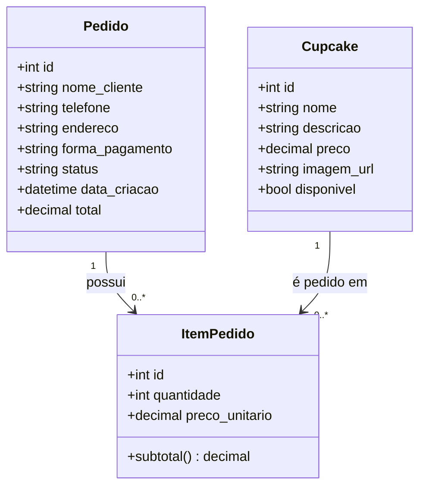

# Diagrama de Classes — App de Delivery de Cupcakes

Diagrama de classes UML (Model da arquitetura MVC), representando as entidades persistidas no banco de dados e seus relacionamentos.

## Notas de modelagem

- **ItemPedido** é uma entidade associativa (classe de associação) entre `Pedido` e `Cupcake`, necessária porque a relação carrega atributos próprios (`quantidade`, `preco_unitario`).
- `preco_unitario` em `ItemPedido` é um **snapshot** do preço do cupcake no momento da compra — garante que alterações futuras no preço do `Cupcake` não afetem pedidos já realizados (integridade histórica).
- `status` em `Pedido` modela o ciclo de vida do pedido: `recebido` → `em preparo` → `saiu para entrega` → `entregue` (string simples nesta versão; pode evoluir para enum/tabela de domínio).
- Não há entidade de usuário/cliente nesta versão — o checkout é feito sem conta, com os dados do cliente armazenados diretamente no `Pedido` (decisão de escopo da Situação 1, documentada para justificar a ausência dessa classe).
